# SOIDL → 3D model compiler (`soidlc`)

`soidlc` is a compiler for **SOIDL** — a declarative, parametric language for
describing MEMS devices fabricated in an SOI process (DRIE of the device
layer, sacrificial BOX release, optional backside trench), in the spirit of
SOIMUMPs.

This repository implements the *"compile a SOIDL description into a 3D model"*
path from the language spec: it parses a `.soidl` source, elaborates the
component/device hierarchy with **unit-checked** expressions, synthesises
per-layer 2D geometry, and **extrudes the layer stack into a watertight 2.5D
3D mesh**, which it exports as STL and OBJ/MTL plus an SVG top-view and a
rendered PNG preview.

The core compiler (parser, geometry kernel, 2.5D extruder, software renderer
and exporters) is pure standard-library Python. The FEM layer (`--fem` /
`--fem-closure`) additionally uses **scikit-fem** and **gmsh**.

| comb resonator | in-plane accelerometer |
| --- | --- |
| 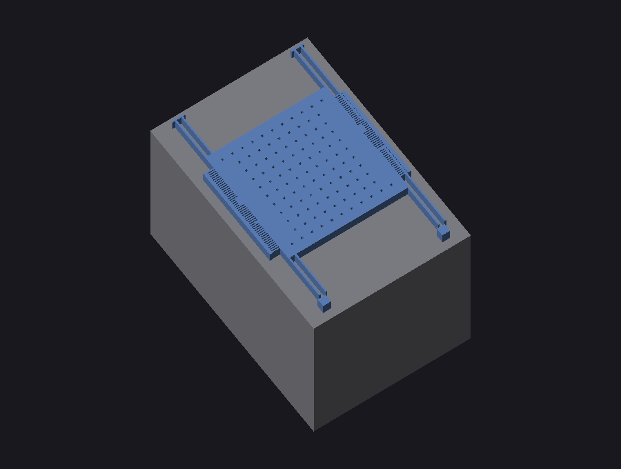 | 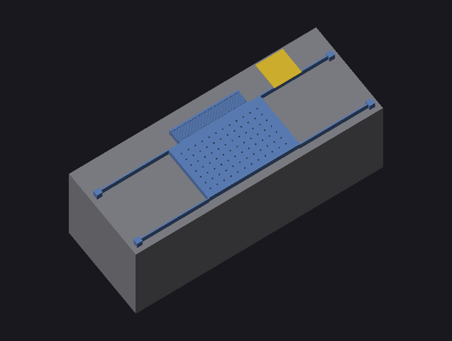 |

*Gray = HANDLE substrate, blue = DEVICE silicon (suspended structures float
above the etched BOX), gold = METAL bond pad. Release holes are generated
automatically from the process rules.*

## Quick start

```bash
python -m soidlc.cli examples/comb_resonator.soidl
# or, after `pip install -e .`
soidlc examples/comb_resonator.soidl -o out/comb
```

Output (written next to `-o/--out` prefix, default `out/<stem>`):

```
process : soi25 (4 layers)
mesh    : 2520 vertices, 4836 triangles; bbox = [396.0 x 588.0 x 427.0] um
model   : m=6.07e-09 [mass], k=406.3 [stiffness], f0=41192.7 [freq]
files   :
          stl  out/comb_resonator.stl     # 3D mesh (binary STL)
          obj  out/comb_resonator.obj     # 3D mesh + per-layer materials
          svg  out/comb_resonator.svg     # top-view layout preview
          png  out/comb_resonator.png     # shaded isometric render
report  : derive/check/solve results with evaluated values
```

CLI flags: `-o/--out <prefix>`, `-d/--device <name>` (which device to build),
`--no-handle` (omit the substrate slab), `--fem` / `--fem-h <um>` (run the
scikit-fem plane-stress modal FEM), `--fem-closure` (FEM-in-the-loop design
closure), `-q/--quiet`.

## How it works

The pipeline mirrors the `soidlc` stages from the spec:

1. **Lex + parse** (`lexer.py`, `parser.py`) — recursive-descent parser for
   `process` / `component` / `device`. Numeric literals carry units
   (`200 um`, `20 kHz`, `2330 kg/m^3`); the lexer attaches a unit to a number
   only if the trailing word is a real unit.
2. **Units** (`units.py`) — every quantity is stored in SI base units with a
   dimension vector `(length, mass, time, current)`. Arithmetic propagates
   dimensions and a mismatch (`length + freq`) is an error. `derive`/`check`
   expressions are evaluated and reported with their dimensions.
3. **Elaboration** (`elaborate.py`) — resolves `import` declarations against
   the importing file's directory and then the bundled standard library
   (`soidlc/lib/`), resolves parameters, expands `repeat` loops and component
   hierarchy, instantiates `array(...)`, and applies placement: `at (x, y)`, `attach (rotor -> M.left)`, and
   `place = corners(M)` (resolved from instance bounding boxes). Produces a
   flat list of layer-tagged 2D polygons in micrometres.
4. **Geometry synthesis** (`primitives.py`) — 17 parametric generators:
   structure (`beam`, `plate` and `disk` with auto-generated release holes
   from the process `release` rules, `anchor`, `ring`, `meander`, `gap_stop`),
   transducers (`comb`/`combdrive`, `parallel_plate`, `chevron`, `hot_arm`),
   metal (`via_metal`, `pad`, `route`, `route_path`), and `trench`, the
   backside opening that cuts the handle slab.
5. **Connectivity extraction** (`connectivity.py`) — in SOI the structural
   layer is conductive, so electrical nodes are exactly the connected
   components of the DEVICE polygons. The compiler computes them (union-find
   over polygon overlap/abutment) and verifies the declared netlist against
   geometric reality, the MEMS analogue of LVS:
   - a `net` split across disconnected islands → **error**;
   - two different `net`s on one island → **short, error**;
   - `isolate A from B by trench` sharing an island → **error**;
   - an island with no anchored geometry → **error** (a fully released
     island has nothing holding it and would detach during release);
   - a device that declares a stiffness while its proof mass touches an
     anchor directly → **warning: suspension bypassed**. An anchor a few µm
     out of place welds the mass to the substrate, and nothing else objects:
     it is one legal island with an anchor and no shorts, and `derive k.x` is
     arithmetic that never sees the silicon. On a real case that reported
     24.1 kHz where FEM measured 220.1 kHz. A warning rather than an error,
     because the same geometry without the claim is legitimate — a clamped
     membrane rim is exactly that.

   Holes do not conduct: a shape sitting inside a release hole or a ring's
   bore is a separate island, not fused with the shape whose hole it occupies.
   Violations are printed as `soidlc: ERROR:` and the exit code is 2
   (artifacts are still written to aid debugging). The check is real: while
   wiring it up it caught two genuine bugs in this repo — comb rotor finger
   tips abutting the stator backbone (zero tip gap = short) and flexure
   anchors placed 6 um short of their beams (floating islands).
6. **Mechanical status from the stack** — each DEVICE polygon is `anchored`
   (BOX kept beneath, tied to the handle) or `released` (floating above the
   BOX gap). This drives the 3D build, not an annotation.
7. **2.5D extrusion** (`mesh.py`, `build3d.py`) — the process `stack`
   assigns each layer a z-range; polygons are extruded into prisms. Anchored
   silicon gets a BOX pillar; a HANDLE slab spans the footprint. Rectilinear
   shapes use a shared-grid voxel-surface mesher → **watertight,
   T-junction-free** geometry (verified in tests).
8. **Model extraction** — a lumped model is assembled from the geometry:
   suspended mass `m` from released DEVICE area × thickness × ρ, stiffness
   `k` from flexure `derive`s, and the resonant frequency
   `f0 = √(k/m)/2π`.
9. **Built-in 2D FEM** (`fem2d.py`, opt-in via `--fem`) — a small pure-Python
   plane-stress solver that verifies the lumped model against the actual
   geometry. Each suspended island is meshed on a tensor grid of rectangles
   (release holes are smeared into the mass density; comb fingers are lumped
   as point masses on their backbone); everything under `anchored` shapes is
   clamped — the boundary conditions come from the release analysis, not
   from annotations. Elements are Q4 rectangles enriched with Wilson
   incompatible modes (so slender flexure elements don't shear-lock), solved
   with a banded Cholesky factorisation and inverse iteration for the lowest
   modes. Validated against Euler–Bernoulli beam theory to <1% (see tests);
   on the examples mode 1 lands within a few percent of the lumped f0:

   ```
   fem    island #1: 1260 elements, 2904 free dof (h = 12 um)
   fem    island #1 modes: 30.93 kHz, 753.96 kHz, 754.54 kHz
   fem    mode 1 vs lumped f0: 30.93 kHz vs 29.15 kHz (+6.1%)
   ```

   `--fem-h <um>` controls the target element size (default 12 µm). The
   solver earned its keep immediately: it exposed that the original
   accelerometer suspensions overlapped the proof mass over half their
   length (FEM read 2.8× the lumped frequency — exactly the ×8 stiffness of
   the halved beams), which led to the outward-mirrored `corners()`
   placement semantics.

10. **Design closure** (`closure.py`, `metrics.py`) — the inverse-design
    stage: dimensions are *outputs*, not inputs. Every
    `solve <param> such that <equation> [within tol]` declares a free design
    variable (its declared value is just the initial guess), and every
    `require <inequality>` adds a hard constraint. The compiler
    re-elaborates the device with candidate values (quiet mode: no reports,
    no DRC), evaluates the spec through metric functions computed from the
    fresh geometry (`f_res`, `stroke_max(V)`, `stroke_static(V)`,
    `Q_estimate`, `area`), and minimises the total violation with
    Nelder–Mead. The example resonator is *synthesised* from its spec:

    ```
    solve S.L  such that f_res(M, S) == f0_target within 1%;
    solve D1.N such that stroke_max(V_drive) == 8 um within 5%;
    require stroke_max(V_drive) >= 5 um;
    require f_res(M, S) >= 15 kHz;
    ```
    ```
    closure: solved S.L = 282.472 um  [f_res(M, S) == f0_target; residual -0.09%, ok]
    closure: solved D1.N = 17.1955    [stroke_max(V_drive) == 8 um; residual -0.09%, ok]
    closure: 48 design evaluations, total penalty 1.684e-06
    require stroke_max(V_drive) >= 5 um: ok (actual: 7.9927 um)
    ```

    A violated `require` on the final geometry is a compile error, same as a
    connectivity mismatch. The whole closure loop runs in ~1 s (each
    design evaluation is a quiet re-elaboration, ~10 ms). Equations are
    weighted by their `within` tolerances, so the optimiser spends its
    budget where the spec is tight.

    **FEM in the loop** (`--fem-closure`): the lumped model carries a
    systematic bias versus FEM (truss compliance, distributed beam mass —
    about +6% here). An outer loop measures that bias on each closed
    design (modal FEM of the suspended island), folds it into the `f_res`
    metric as a calibration factor, and re-solves from the previous
    optimum until the factor converges:

    ```
    closure: FEM calibration pass 1: f_fem=21.18 kHz vs lumped 20.00 kHz -> factor 1.0591
    closure: FEM calibration pass 2: f_fem=20.01 kHz vs lumped 18.89 kHz -> factor 1.0592
    closure: solved S.L = 293.145 um  [f_res(M, S) == f0_target; residual +0.02%, ok]
    closure: solved D1.N = 16.0643    [stroke_max(V_drive) == 8 um; residual +0.44%, ok]
    ...
    fem    island #1 modes: 20.01 kHz, ...
    ```

    The spec is now met by the *FEM-predicted* frequency (20.01 kHz on a
    20 kHz target), with the lumped target internally retargeted to
    18.89 kHz. Total cost: ~9 s (two NM runs + three coarse modal solves).

11. **Model order reduction** (`reduce.py`, runs with `--fem`) — the FEM
    modes are projected into a behavioural model: each mode becomes one
    oscillator `q̈ + 2ζωq̇ + ω²q = φᵀf`, and comb transducers couple in
    through modal participation factors measured at their rotor backbones.
    Transducer data (N, gap, overlap, drive axis, attachment) is re-derived
    from the elaborated geometry, so the model cannot disagree with the
    layout; gas damping (slide film over the BOX gap + comb finger films)
    supplies Q. Effective drive-point parameters replace the naive lumped
    ones (`m_eff = 1/φ₁², k_eff = ω₁²m_eff`). Three exports per device:

    - `<prefix>_model.py` — standalone pure-Python ODE model (RK4 transient,
      analytic frequency response, ring-down self-test);
    - `<prefix>_model.cir` — SPICE Butterworth–Van Dyke subcircuit
      (motional Rm/Lm/Cm from `η = V_dc·dC/dx`, plus C0 feedthrough), ready
      for LTspice co-simulation with readout electronics;
    - `<prefix>_model.va` — Verilog-A module (modal states on internal
      nodes, electrostatic force in, motional current out).

    ```
    rom    transducer D1 (net DRIVE): N=24, g=2.00 um, dC/dx=5.313e-09 F/m, ...
    rom    mode 1 @ drive point: m_eff=5.728e-09 kg, k_eff=2.164e+02 N/m, Q≈617 (air)
    rom    BVD @ V_dc=30 V: Rm=7.106e+07 ohm, Lm=2.255e+05 H, Cm=1.174e-16 F,
           f_series=30.93 kHz
    ```

    The exports are self-verifying: ring-down of the generated ODE model
    reproduces the FEM mode-1 frequency to <0.01%, and the BVD series
    resonance matches by construction (both checked in tests).

    **Noise / dynamic characteristics.** The same damping `b` that sets Q
    also shakes the structure (fluctuation–dissipation: force PSD
    `4·kB·T·b`), which makes the Brownian-limited **Angle Random Walk**
    computable straight from the geometry:
    `ARW = sqrt(2·kB·T·b)/(2·m·ω_d·X_d)` (IEEE-952 convention). It is a
    spec-level metric — `require arw(300 K) <= 0.15;` (deg/√h, dimensionless
    by convention) — and the generated ODE model ships a virtual rate-table
    experiment: Langevin thermal forcing (`simulate_thermal`, validated by
    equipartition `<x²> = kB·T/k` to ~1% in the demo), an overlapping
    **Allan deviation** routine, and `arw_experiment()` whose τ^(−1/2) fit
    reproduces the analytic ARW. With an output prefix the compiler also
    writes `<prefix>_allan.png` — the Allan curve of the simulated run vs
    the analytic slope:

    ```
    require arw(300 K) <= 0.15: ok (actual: 0.0333)
    rom    ARW (Brownian, 300 K, x_d=7.54 um): 0.0355 deg/sqrt(h)
    rom    Allan experiment: ARW_est=0.0355 deg/sqrt(h) vs analytic 0.0355
    ```

    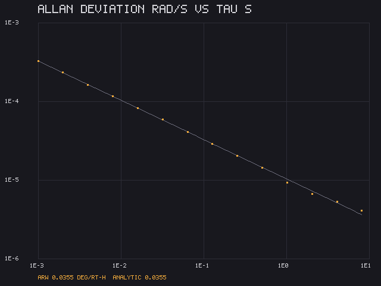

12. With an output prefix, `--fem` also writes deformation pictures: a
    mode-shape panel (grey undeformed mesh + deformed mesh coloured by
    displacement magnitude) and an isometric render of the device deformed
    by mode 1 (exaggerated):

   | mode shapes (comb resonator) |
   | --- |
   | 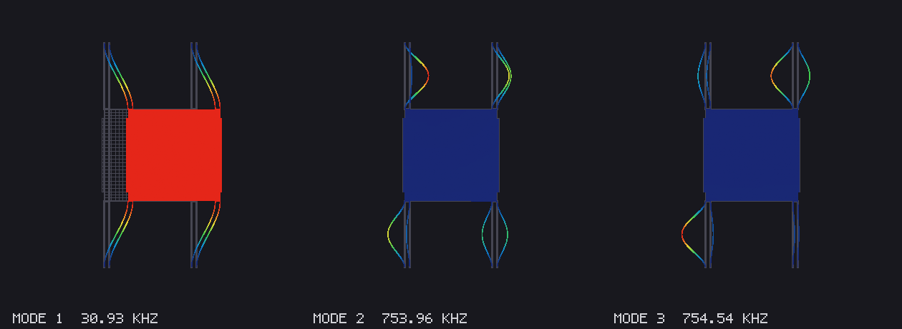 |

   | deformed 3D, mode 1 (comb resonator / accelerometer) | |
   | --- | --- |
   | 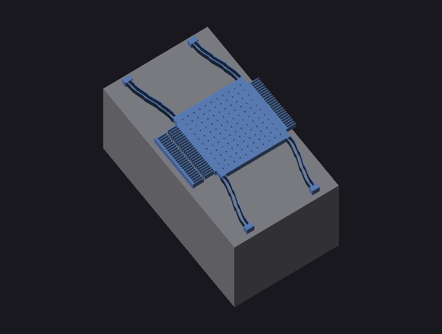 | 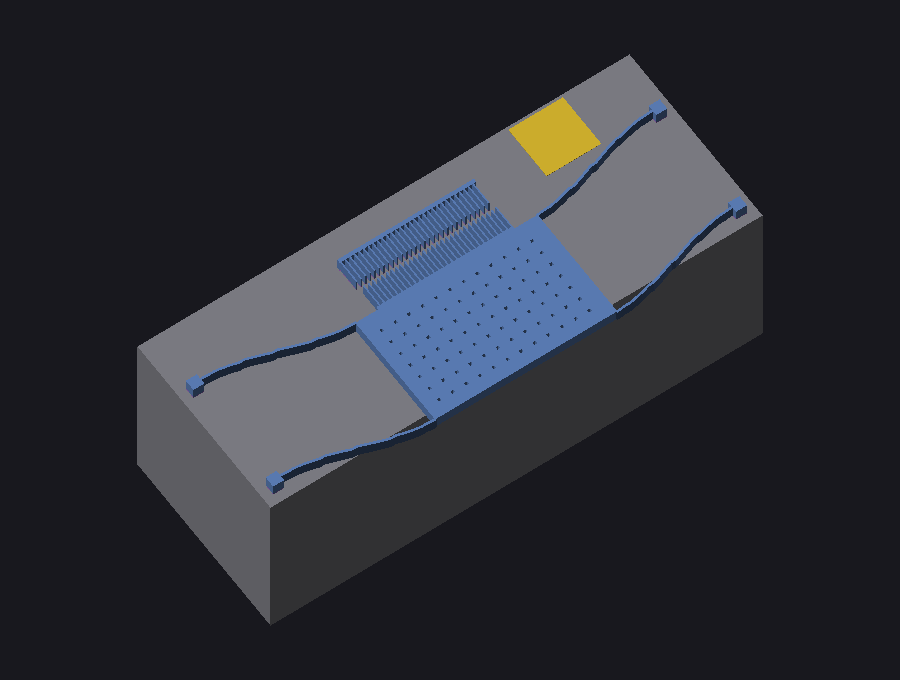 |
10. **Export** (`exporters.py`, `svg.py`, `render.py`) — binary STL, OBJ+MTL
    (per-layer colours), SVG top view, and a z-buffered isometric PNG from a
    built-in software rasteriser.

## Element library

SOIDL ships a standard library written **in SOIDL**, pulled in with `import`:

```soidl
import "flexures.soidl";

device d {
  inst M = plate(300 um, 300 um) at (0, 0);
  inst S = array(folded_flexure(L = 200 um, w = 4 um), count = 4,
                 place = corners(M));
}
```

Imports resolve first against the importing file's directory, then against
the bundled library in `soidlc/lib/`. A local `component` shadows a library
one of the same name, the same rule that already lets a user component shadow
a builtin primitive. An imported file may declare components only.

The split between the two halves of the library is deliberate. Irreducible
parametric geometry — a comb, a ring, a meander path — stays a Python
generator, because expressing it in SOIDL would mean putting loops with
trigonometry into the language. Everything that is a *composition* of
primitives lives in `soidlc/lib/*.soidl`, so the library of a language for
describing MEMS is itself written in that language and a user can extend it
without touching the compiler.

| component | file | stiffness |
| --- | --- | --- |
| `guided_beam` | flexures | `k = n·E·t·w³/L³` |
| `folded_flexure` | flexures | `k = E·t·w³/(L³ + L_out³)` |
| `serpentine` | flexures | `k = E·t·w³/(n·L³)` |
| `crab_leg` | flexures | *none — see below* |
| `torsion_bar` | flexures | `k_θ = G·J/L` |
| `frame` | flexures | — |
| `membrane` | membranes | — |

### What the FEM validation actually caught

The stiffness formulas above are checked against the scikit-fem solvers, and
that check was not a formality. Three of the flexures were **rigid blocks**
that every other check in the compiler passed:

| element | first attempt | after |
| --- | --- | --- |
| `folded_flexure` | 192.8 kHz, then 220.1 kHz | **26.5 kHz** (+2.2% vs lumped) |
| `serpentine` | 448.6 kHz | **43.6 kHz** (+12.2%) |
| `micromirror` | one bar buried in the plate | both bars symmetric |

Every one of those was a single legal electrical island, so the LVS check was
satisfied, and `derive k.x` is arithmetic that cannot know the silicon it
describes is rigid. The failures were: an anchor wide enough to touch its own
flexure's beams; anchors placed on the proof-mass side, bolting the mass to
the substrate; meander spans all reaching the mass, so they acted in parallel
rather than in series; and a torsion bar placed with `at` instead of `attach`,
which left it inside the plate it was supposed to hinge.

`tests/test_library.py` therefore carries geometric tests as their own class —
no anchor may touch the proof mass, each anchor grips exactly one beam, no
anchored beam may also reach the mass — because none of these are visible to
the parser, the unit checker, or the netlist extractor.

`crab_leg` ships with **no** stiffness formula. The textbook expression
measured 38.7% low against FEM (67.4 kHz against 48.6 kHz predicted): for
motion along x the thigh is loaded axially and contributes almost no bending
compliance, so the formula attributes it to the wrong member. Calibrating a
fudge factor would have hidden exactly the physics the validation exists to
expose, so the component reports no `k` at all and `f_res()` raises rather
than returning a number.

### Out-of-plane devices

`layer HANDLE` and `mask TRENCH -> etch(HANDLE, through, backside)` were
declared by every example process from the start and used by none:
`prim_trench` returned nothing and the handle was an unbroken slab. `trench`
now emits a footprint that `build3d` subtracts from the substrate and its
oxide, which is what makes membranes and torsional devices expressible.

A torsional mode is governed by the mass moment of inertia, not the mass.
`f0 = √(k/m)` fed a mirror does not raise — it returns a plausible,
meaningless number — so the model reports `k_θ`, `J_m` and `f0_theta`
separately, and a bare `f_res()` on a purely torsional device **raises**:

```
this device has only a torsional mode; call f_res(axis = theta).
A translational f_res would divide a torsional stiffness by a mass and
return a meaningless number
```

The teeter-totter accelerometer is validated against the 3D solid solver
(`soidlc/fem/solid3d.py`), which is the only one that can see the mode at
all: 3D mode 1 lands at 12430 Hz against a lumped 11319 Hz (+9.8%), and the
test also asserts the mode is genuinely antisymmetric about the hinge rather
than merely close in frequency.

## Process simulation (feature scale)

Alongside the device pipeline there is a family of feature-scale **fabrication**
simulators — physical level-set etch models, not geometry offsets. They share a
single C99 + OpenMP upwind-Godunov level-set core (`levelset.c`); each process
adds only its velocity field (`bosch.c`, `drie.c`, `wet.c`, `corner.c`), and the five
compile together into one `etch_core.so`, auto-built on first use with the
system compiler and driven through `ctypes` (pure-Python fallback where
practical):

- **Bosch DRIE** (`etch.py`) — time-multiplexed deep reactive-ion etch of the
  structural layer. A polymer/passivation field protects sidewalls while
  directional ions drill the trench bottom, reproducing scalloping, ARDE /
  RIE-lag (from a ray-cast sky-visibility factor), footing/notching at the
  buried oxide, and positive/negative taper & bowing.
- **Recipe physics** (`recipe_physics.py`) — a semi-empirical map from real
  recipe parameters (SF₆/C₄F₈ flows, coil/bias powers, pressure, step times,
  cycle count) onto the effective etch knobs, with calibratable coefficients and
  process-window warnings (grass risk, mask-selectivity loss).
- **Plasma physics of the recipe** (`plasma.py`) — the same map driven by the
  discharges instead of power laws: `BoschProcess(plasma=FermaPlasma())` runs
  each step of the cycle as a steady discharge of a planar-coil ICP reactor in
  [Ferma](https://github.com/AIOS2/ferma)'s ICP solver (`ferma build -p ...`,
  `ferma mesh`, `ferma_icp`; the reactor models are `soidlc/reactors/*.ferma`):
  the etch step (SF₆, RF bias on the wafer) gives the silicon etch rate, its
  thermal/ion-driven split, the F flux and the ions' energy at the wafer; the
  passivation step (c-C₄F₈) the CF/CF₂/CF₃ flux that deposits the film. The
  vertical rate follows the etch rate, the isotropic/anisotropic balance the
  thermal over the ion-driven share, the passivation the film flux per step
  against the F flux per step, selectivity and footing the ions' energy -- each
  relative to the reference recipe's discharges, so the calibration constants
  keep their meaning. The binaries come from `FERMA` and `FERMA_ICP` (or
  `PATH`); a run takes half a minute (passivation) to three minutes (etch: the
  sheath's particle model), so results are cached per recipe (in memory, and
  on disk with `FermaPlasma(cache_dir=...)`).
- **Bosch DRIE from the plasma's fluxes** (`drie.c`; `etch.simulate(...,
  fluxes=BoschProcess(plasma=FermaPlasma()).fluxes())`) — the profile from what
  the two steps' plasmas deliver, with no effective knobs. F, the ions (their
  flux and energy) and each of the film's radicals fly ballistically into the
  feature from the plasma above: rays from every surface point, the neutrals
  re-emitted diffusely where they do not stick (a radiosity system per
  species, solved with BiCGSTAB), the ions within a 2° spread. The passivation
  step grows a fluorocarbon film from the radicals that stick and the ions
  that arrive; the film is a layer with its thickness (a second level set
  over the substrate's, as in ViennaPS), so it narrows an opening and its
  foot shields the silicon below. The etch step's ions and F wear it down;
  where it is gone, silicon is etched through adsorbed F as on Ferma's wafer
  (Belen et al., JVST A 23, 99 (2005): F sticking, thermal and ion-enhanced
  removal; the thermal removal ten times theirs, as Ferma's, from the
  unbiased etch rate of Tinck et al., Plasma Process. Polym. 14, e1700018
  (2017)), undercutting the film above (scallops). The mask is worn by the
  ions and F. A bias on the passivation step (`BoschProcess.pass_bias_w`, or
  the measured self-bias `pass_bias_v`; Ferma gives the ions' energy) makes
  its ions wear the film down as well, with the film's yield at their
  energy, where they reach it (the open surface and the bottom, not the
  walls): where they take more than the radicals bring, the film thins, down
  to the substrate. The ions' yields are the same at every angle; ray by
  ray, the film's and the mask's can instead rise off the normal as a
  sputtering yield does (`SurfaceKinetics.poly_angular`, `mask_angular`: (1 +
  B sin²θ) cos θ, ViennaPS's PlasmaEtching form, B 8.5 and 9.3 there; off,
  see the Craigie comparison). The reactors carry each step's bias as `P_b` or `V_b`,
  0 for none (needs Ferma #129: 0 as no bias, and the sheath over a wafer
  without a chemistry of its own, as under C₄F₈).

  The film's radicals are Ferma's species, each with the probability that
  one arriving at the film joins it, measured where there are measurements
  (`soidlc/film.py`), on a feature's walls, which no ions reach: CF 0.5
  (IRIS, Cuddy, Blechle & Fisher, IJMS 330, 46 (2012)), CF₂ 5e-4 (the
  largest flux hardly builds the film: it scatters with S = 0.9 - 1.3 with the
  ions removed, IRIS, Martin & Fisher, JVST A 22, 2168 (2004); 1.5e-3 in Huang
  et al.'s model, 0.014 on the ion-activated walls of a reactor; 5e-4 keeps
  Zhang et al.'s trench as straight as their SEM shows it),
  CF₃ and C₃F₅ 0 (one dangling bond: they cannot join the film's network,
  Zhang & Kushner, JVST A 19, 524 (2001)), C 0.5 and C₂F₄ 1e-3 (not measured;
  model values). A radical that sticks readily coats the top of a feature, one
  that rarely does reaches its depth: the few that do decide the walls' taper. The ions' film, the film's removal and the mask's
  are the published set of Kokkoris et al., JVST A 22, 1896 (2004) (as in
  Ertl & Selberherr 2010 and ViennaPS's Bosch example); F's removal of the
  film (0.03 ų per F) is at the measured upper bound (Standaert et al.,
  JVST A 16, 239 (1998): no significant etching by F alone), and the ions'
  (125 ų per ion at 100 eV) near the 85 ų measured in SF₆ (Nos, PhD thesis,
  Université d'Orléans (2025)). `BoschFluxes.from_plasmas` takes the F flux
  and silicon's ion term that give the plasma's own etch rate and ion-driven
  share, so an open flat surface etches exactly as Ferma's wafer. One
  constant is the tool's: the film's growth, set by
  `BoschFluxes.calibrated(breakthrough)`, the seconds the etch step takes to
  clear one passivation step's film off an open surface (it scales every
  radical's film and the ions' alike; `growth_scale` reports by how much).
  The front's speed is grid-independent (a flat surface to 1e-3, a 2 µm
  trench to 1 % from 40 to 10 nm cells).

  **Against a published recipe** (`recipe_physics.ZHANG2023`, `zhang2023()`):
  Zhang et al., Micromachines 14, 846 (2023), an Oxford Plasmalab 100 ICP180,
  700 W; 8 s of SF₆ at 40 mTorr with 25 W of bias, 10 s of C₄F₈ at 30 mTorr;
  a 6 µm spiral trench under 6 µm of AZ4620, 1.3 % of the 6-inch wafer open.
  Its plasmas are Ferma's for an ICP180-like reactor (`reactors/icp180_*.ferma`:
  the tool's drawings are not published, so the source is a 180 mm tube with a
  three-turn coil; needs Ferma's `wafer_open_fraction`): the open silicon etches
  at 6.9 µm/min, 71 % of it without the ions (a bare wafer would take up the F:
  1.3). Ferma's C₄F₈ walls take up CF and C as film-coated walls do (Ferma
  #127, against measured CF, CF₂ and C densities); with inert walls its CF
  was 12 and its C 100 times higher here. The plasma's radicals with their
  measured sticking grow 117 nm of film per passivation step (CF 94 % of it);
  a breakthrough of 7.7 s fits the depth, 82 nm per step, 0.7 of it (with
  inert walls 0.04):

  | | model | measured |
  |---|---|---|
  | depth after 100 cycles (fitted) | 30.8 µm | 30.72 µm |
  | scallops (peak to valley per cycle, mean over the cycles, 25 nm cells) | 72 nm | 70 - 80 nm |
  | advance per cycle, first 12 cycles | 396 nm | 307 nm (mean of 100) |
  | walls 1 / 10 / 20 / 28 µm down (CF₂'s sticking set to it) | 5.2 / 5.0 / 4.7 / 4.8 µm | 5.9 µm at the bottom (fig. 4b) |

  The scallops follow from the radicals' sticking. With one radical of the
  published film growth sticking 0.1 everywhere (Kokkoris et al.'s), the
  vertical mask walls gained 33 nm of film a cycle, closed the opening and
  stopped the trench at 6 µm: F's measured removal and the few ions reaching
  a vertical wall cannot take it off, so the walls' film is what the rarely
  sticking radicals leave there, and the walls' angle rests on them: CF₂ at
  0 leaves the walls deep down unprotected (the trench bows to 10 µm wider),
  at 1.5e-3 it narrows to 3.6 µm, and 5e-4 keeps it straight (fig. 4b shows
  5.9 µm at its bottom). Not modelled: the steps' gas switching in time,
  charging and the 5 sccm admixtures. The passivation step's 10 W of bias is
  left out of the table: with it (`pass_bias_w=10`; Ferma's sheath, 198 V,
  the ions at 200 eV wearing off 3.8 of the radicals' 11.7 nm/s) a
  breakthrough of 7.45 s fits the depth (30.8 µm), but the film's growth has
  to be 1.43 times higher to make up for the ions, the walls (which no ions
  reach) get that much more, and the trench narrows: 5.6 / 5.0 / 4.4 / 4.0
  µm.

  **The walls' angle against the passivation** (`recipe_physics.CRAIGIE2002`,
  `TestCraigie2002`): Craigie et al., JVST B 20, 2229 (2002), an Oxford
  Plasmalab System100, 50 µm trenches under 10 µm of resist, 45 min of 15 s
  SF₆ steps (85 sccm, 30 mTorr, 450 W, 30 W of bias) and C₄F₈ steps (35
  mTorr, 450 W), the angle measured against the passivation step's length
  and C₄F₈ flow. Its plasmas are Ferma's on the ICP180 reactors (10 % of the
  wafer open: an assumption), the film's growth scaled as Zhang et al.'s fit,
  nothing fitted to it. Degrees inside the silicon from the wafer's surface,
  above 90 narrowing downwards:

  | C₄F₈ 60 sccm, passivation | 5 s | 7 s | 10 s | 12 s | 15 s |
  |---|---|---|---|---|---|
  | measured | 88.9 | 89.4 | 89.75 | 90.5 | 90.6 |
  | model, 250 nm cells | the walls' film breaks through | 87.8 | 90.2 | 91.7 | 93.8 |
  | model, 125 nm cells | | 88.8 | 90.7 | 91.7 | |
  | model, 62.5 nm cells | | 89.2 | | 92.0 | |

  | passivation 10 s, C₄F₈ | 15 sccm | 20 | 30 | 60 | 80 |
  |---|---|---|---|---|---|
  | measured | 87.0 | 89.2 | 88.9 | 89.75 | 89.85 |
  | model, 250 nm cells | 85.9 | 86.9 (125 nm: 88.0) | 88.6 | 90.2 | 90.8 |

  The trends and where the walls turn vertical (10 s and 60 sccm; measured
  11 - 12 s and 50 sccm) come out without a fit. The angle needs fine cells:
  the walls' film is 30 - 60 nm (at 500 nm the 20 sccm case narrows to 95.7
  degrees); on 62.5 nm cells the bowing at 7 s is the measured one (89.2
  against 89.4 degrees) and the narrowing at 12 s 1.4 degrees too much (92.0
  against 90.5): with a thick film the walls keep more of it than on the tool
  (the fluorocarbon the gas switching leaves in the etch step is 1 - 2 % of
  the passivation's in Ferma's transient model, too little). The passivation
  step's bias is not the cause: with its measured 110 V (`pass_bias_v=110`;
  Ferma's sheath at that voltage takes 2.5 W of the tool's 15 W over the 150
  mm wafer, its ions at 115 eV wear off 1.15 of the radicals' 7.4 nm/s) and
  Zhang et al.'s 10 W in the calibration, the walls narrow more, as Zhang et
  al.'s do: 90.0 and 93.8 degrees at 7 and 12 s on 250 nm cells, 90.1 and
  93.8 on 125 nm; the swing from 7 to 12 s stays 3 - 4 degrees against the
  measured 1.1 (the measured 150 V of the etch step, against Ferma's 296 V
  for 30 W over the wafer, would need Zhang et al.'s voltages too, which are
  not given). Nor is the ions' yield on the oblique film of the bottom's
  corners: with the film's and the mask's yields rising off the normal as
  ViennaPS's sputtering form has them (B 8.5, 9.3, ray by ray), the corners
  clear sooner, Zhang et al.'s depth then needs a breakthrough of 11.15 s
  (growth 1.45 times higher; their walls 5.8 / 5.0 / 5.2 / 5.0 µm), and
  Craigie's angles come out 89.7 and 92.0 degrees at 7 and 12 s on 250 nm
  cells, but 88.8 and 91.7 on 125 nm, as without it: the higher growth puts
  back on the walls what the corners lose. Zhang et al.'s scallops grow to
  103 nm (measured 70 - 80), so the yields stay the same at every angle.
  Left: the ions reflected from the walls. On 250 nm
  cells 5 s of passivation break through the walls' film where the
  measurement shows 89 degrees. Ferma's global model does not converge for 5
  and 10 sccm of C₄F₈ at 450 W.
  **Against ViennaPS** (`tests/test_drie.py::TestAgainstViennaPS`): its Bosch
  example (Ertl & Selberherr 2010, the same Kokkoris et al. coefficients; its
  ions' yields the same at every angle, `B_sp` -1, as here) in
  2D, run in ViennaPS 4.7.0 on a 25 nm grid; here with silicon's linear law
  (`SurfaceKinetics.si_alpha`, `si_beta`: 270 ų per ion, 0.9 ų per F, F
  sticking 0.2) in place of Belen's. A 2 µm trench under 0.6 µm of mask, 10
  cycles of 5 s of film and 11 s of etching:

  | | here (25 nm cells) | ViennaPS |
  |---|---|---|
  | 6 s of the etch step without film: depth | 0.559 µm | 0.563 µm |
  | the same: wall 0.1 / 0.3 / 0.45 µm down, from the centre | 1.288 / 1.208 / 1.045 µm | 1.281 / 1.208 / 1.052 µm |
  | 1 cycle: depth | 0.516 µm | 0.490 µm |
  | 1 cycle: undercut below the mask (25 / 12.5 nm cells) | 0.23 / 0.28 µm | 0.18 / 0.23 µm |
  | 10 cycles: depth | 4.58 µm | 4.46 µm |
  | 10 cycles: mask left | 0.352 µm | 0.350 µm |
  | 10 cycles: wall 1 / 2 / 3 / 4 µm down | 1.14 / 1.11 / 1.03 / 1.04 µm | 1.16 / 1.09 / 1.01 / 1.04 µm |

  Without the film the two agree to 0.01 - 0.03 µm (the F's and ions'
  transport and the undercut below the mask), with it to 0.05 µm on the
  walls, and the depth and the mask's wear agree. The undercut below the
  mask in the first cycle is not converged in either at 25 nm (the 47 nm
  film is two cells).
- **Anisotropic wet etch** (`koh.py`) — KOH/TMAH bulk micromachining with an
  orientation-dependent rate: {111} planes ~100× slower meet a (100) surface at
  54.74°, so a mask opening self-organises into the classic facetted pit /
  V-groove / inverted pyramid (2D and full 3D, with STL heightmap export).
- **Corner compensation** (`corner.py`, below) — convex-corner undercut and the
  sacrificial mask structures that defeat it.
- **Wafer bonding** (`assembly.py`) — bond a cap wafer over the device, forming a
  sealed cavity; recomputes Q for the encapsulated gas environment (vacuum
  sealing lifts Q from ~10² toward the anchor/TED-limited ceiling).

### Convex-corner undercut & compensation

On a (100) wafer a *concave* feature (an etch pit) self-terminates on the slow
{111} planes and stays sharp, but a *convex* corner — the outside corner of a
mesa or boss you want to **keep** — exposes the fastest intermediate planes
(≈{410}/{310}, ~28° off ⟨110⟩) at its 45° bisector and is beveled/undercut by
roughly `U ≈ ratio · depth` (ratio ≈ 1.4–1.8 for KOH). `corner.py` simulates the
mask undercut directly with a **plan-view** (top-down) level-set whose front
speed follows the in-plane etch-rate diagram `R(θ)`:

- normal along ⟨110⟩ (θ = 0): a {111} sidewall forms → ~zero undercut (`r_slow`);
- normal near ⟨410⟩ (θ ≈ 28°): the fastest planes → peak undercut `r_peak`;
- normal along ⟨100⟩ (θ = 45°): an intermediate {100}-sidewall rate `r100`.

That three-rate diagram matters: lumping ⟨100⟩ in with the corner would be wrong,
and the gap between `r_peak` (corner) and `r100` (a ⟨100⟩ sidewall) is exactly
why a ⟨100⟩ beam can shield a corner. A **corner compensation structure** is
extra sacrificial mask at the convex corner, sized so the fast-plane undercut
consumes the sacrifice and only just reaches the true corner at the target depth:

- `square_comp(corner, size)` — a ⟨110⟩ square centred on the corner; its
  sidewalls run along the slow {111} so only its outer corner bevels in. Robust;
  protects once `size > √2 · U`.
- `bar_comp(corner, outx, outy, length, width)` — a ⟨100⟩ beam projecting
  diagonally outward; area-efficient but sacrificial (its own ⟨100⟩ sidewalls
  undercut at `r100`, so it must be wide enough, `width ≳ 2·r100·U`).

```
python3 examples/corner_demo.py
anisotropic etch: depth 20 um, convex-corner undercut budget 30.0 um
a <110> compensation square protects when its side > sqrt(2)*U = 42.4 um
bare mesa:          corner (50,50) survives? False   (all four beveled off)
compensated (48um): corner (50,50) survives? True    (all four kept sharp)
```

| bare mesa — convex corners beveled | with ⟨110⟩ corner compensation |
| --- | --- |
| 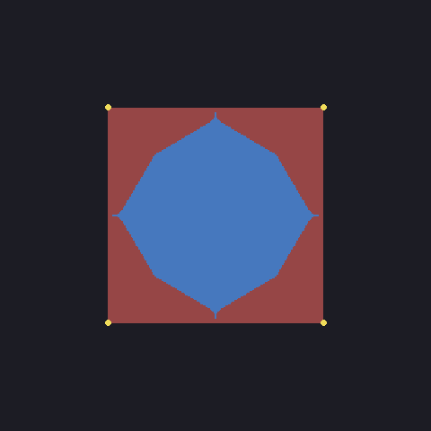 | 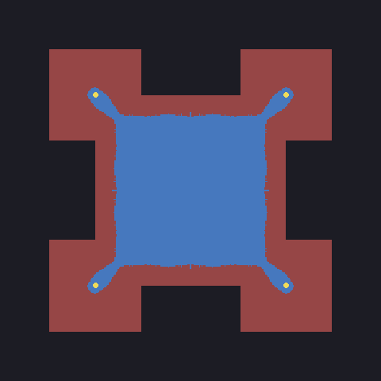 |

Blue = silicon that survived the timed etch, red = mask area lost to undercut.
The bare 100 µm square erodes to an octagon; the compensated one keeps square
corners (reaching the yellow corner marks), the compensation squares spent down
to small tabs. *Limitation:* the in-plane normal is taken from central
differences, so concave mask corners round by a few µm instead of staying
perfectly sharp — fine for sizing compensation (the convex topic), not for
absolute concave-corner geometry.

### Calibrated crystal etch-rate diagram

The closed-form KOH model above carries three numbers (`r100`/`r110`/`r111`).
`crystal_rates.py` replaces that with a **data-driven** anisotropy map: it
stores *measured* low-index plane rates for named process conditions (KOH
30 %/70 °C, KOH 44 %/85 °C, TMAH 25 %/80 °C — representative literature anchors,
Seidel 1990 / Sato 1999, calibratable) and reconstructs a continuous,
cubic-symmetry-correct rate diagram `R(n)` over the unit sphere by symmetry-aware
RBF interpolation (each `{hkl}` anchor expanded over the 48 operations of `m-3m`).

```
python3 examples/crystal_demo.py
KOH 30wt% / 70C   (anchors -> 74 symmetry-equivalent normals)
   R(1, 0, 0) =  0.8000 um/min   (1.00x R100)
   R(1, 1, 0) =  1.4000 um/min   (1.75x R100)   <- {110} fastest low-index
   R(1, 1, 1) =  0.0105 um/min   (0.01x R100)   <- {111} self-terminating
   anisotropy R100/R111 = 76
```

The diagram is sampled into a `(theta, phi)` lookup table (in the **wafer**
frame, so arbitrary orientation is just a rotation of the crystal axes) that a
dedicated kernel — `wet_run_3d_tab` — reads per cell with bilinear interpolation.
So the crystallography is *data* fed into the level-set, not hard-coded geometry.
`koh.simulate_3d(..., diagram=d, orientation="100"|"110"|"111")` switches the 3D
etch onto it; `crystal_rates.render_diagram` draws the stereographic map (blue
{111} cusps, red {110} lobes, four-fold symmetric):

| KOH 30 %/70 °C rate diagram (stereographic, (100) frame) |
| --- |
|  |

Changing the wafer cut changes the geometry from the same mask: a (100) wafer
self-terminates into 54.74° {111} pyramids/V-grooves, while a (110) wafer (its
{111} planes run perpendicular to the surface) etches deeper, near-vertical-walled
trenches — reproduced by the kernel directly from the rotated table.

Because the anisotropy lives in the *crystal*, the same machinery covers the two
ways geometry degrades, each just another rotation of the sampled table
(`simulate_3d(..., misalign_deg=…, miscut_deg=…, miscut_az=…)`):

- **mask misalignment** — turning the mask off the wafer flat (`misalign_deg`)
  spins the crystal pattern under the (grid-aligned) mask. Straight ⟨110⟩ edges
  stop being slow {111} and undercut hard — in the plan-view model a square mesa
  edge recedes **0.6 µm aligned but 11.7 µm at only 8°**, peaking near 30° (the
  fast ⟨410⟩ plane); in 3D the pit stops self-terminating (its floor stays
  ~24 µm wide at 30° instead of pinching to a 4.8 µm pyramid apex). This is why
  flat alignment is critical.
- **off-axis / vicinal wafer** — a `miscut_deg` tilt of the surface normal off
  the ideal pole decenters the diagram, so a pyramid's four facets are no longer
  equal and it tips to one side.

| (100) aligned | mask misaligned 22° | 10° miscut (off-axis) |
| --- | --- | --- |
| 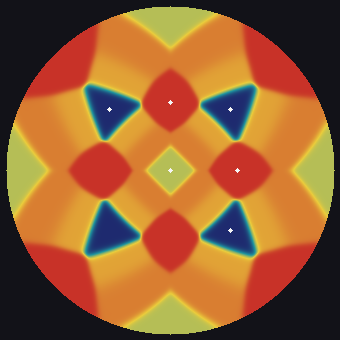 | 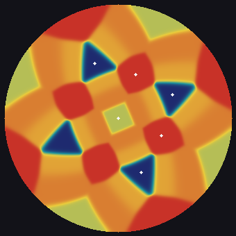 | 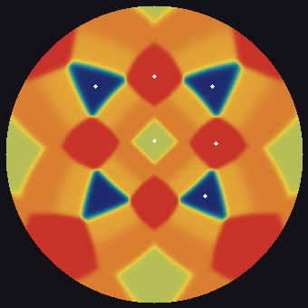 |

(Stereographic R(n) in the wafer frame: misalignment **rotates** the {111}
cusps under the mask, the miscut **shifts** them off-centre.)

### Thin masking film with finite selectivity

The default 3D etch treats the mask as a perfect, infinitely thick guard
(the whole masked column is protected). `simulate_3d(..., film_mask=True)`
instead models the real situation: a thin masking **film** (thickness
`mask_thick`) that is itself slowly etched, at the vertical rate divided by
`recipe.selectivity`. The film is kept out of `phi` (which is just the
silicon); a per-column thickness field protects each column's top while it
lasts and is returned in `WetResult3D.film`. So the film is a *finite resource*:

```
film mask in the bath, 2 um film:
  sel=50, 200 steps:  film 1.59 um left,  Si top intact      (mask holds)
  sel= 8, 200 steps:  film consumed,      Si top etched 4.2 um (mask FAILS)
```

Once the film is gone the silicon underneath is exposed and etches — exactly
how a real oxide/nitride mask is eventually undercut/eroded in a long KOH etch.
Silicon is also undercut laterally from the opening edges (the released-membrane
regime). *Limitation:* this single-`phi` model does not reproduce the
inclined-{111} self-limiting that spares a perfectly ⟨110⟩-aligned edge —
faithful mask-edge undercut needs explicit facet tracking, which the lookup
kernel here does not do.

## Supported SOIDL subset (v0.1)

Implemented: `import "name.soidl";` (top level only, resolved against the
importing file then the bundled `soidlc/lib/`), `process { stack / masks /
rules }`, `component(params) { port, derive, geometry, check }`,
`device { inst, net, isolate, constraint, check, solve }`; `repeat` loops,
`array`, placement/attachment (with automatic orientation:
`attach (rotor -> M.top)` rotates the comb so the rotor faces the plate),
unit-checked expressions, primitives listed above, and full connectivity
extraction with `net`/`isolate` verification.

Not implemented, and it shapes the library: SOIDL has **no list literal**, so
a primitive taking a polyline (`route(points, w)`) would be callable only
from Python. `route` therefore takes a length and a direction like `beam`
does, and `route_path` covers the polyline case for Python callers.

Best-effort / partial: `solve` (a numeric fallback length is used unless a
closed-form is known); `constraint` calls are reported but not enforced
(island anchoring is checked independently); DRC rules beyond release-hole
generation are not yet enforced. Behavioural
exports (Verilog-A / SPICE) and FEM hand-off are out of scope for this v0.1,
which targets the 3D-model deliverable. Unknown functions inside
`derive`/`check` degrade gracefully to a symbolic report entry rather than
failing the build.

## Layout

```
soidlc/
  units.py       dimensional quantities + unit parsing
  lexer.py       tokenizer (unit-aware numbers)
  parser.py      recursive-descent parser
  sast.py        AST node definitions
  primitives.py  primitive -> 2D polygon generators
  lib/*.soidl    standard library, written in SOIDL (flexures, membranes)
  elaborate.py   hierarchy expansion, placement, model extraction
  connectivity.py electrical island extraction + net/isolate verification
  fem2d.py       pure-Python plane-stress FEM (Q6 elements, modal/static)
  reduce.py      model order reduction -> Python ODE / SPICE BVD / Verilog-A
  femplot.py     mode-shape panels + deformed 3D renders
  geometry.py    2D polygon kernel
  mesh.py        triangulation + 2.5D extrusion (watertight grid mesher)
  build3d.py     stack-aware mesh assembly (anchors/box/handle)
  exporters.py   STL + OBJ/MTL writers
  svg.py         top-view SVG preview
  render.py      pure-Python PNG software renderer
  cli.py         `soidlc` command-line entry point
  levelset.{c,h} shared C99+OpenMP upwind-Godunov level-set core
  bosch.c        Bosch DRIE velocity field + entry point
  drie.c         Bosch DRIE from the plasma's fluxes (transport, film, kinetics)
  wet.c          KOH/TMAH anisotropic velocity field (2D + 3D)
  corner.c       plan-view convex-corner undercut velocity field
                 (the four above compile together into etch_core.so)
  etch.py        Bosch DRIE feature-scale simulation
  recipe_physics.py recipe params -> effective etch knobs
  plasma.py      the recipe's etch and passivation plasmas from Ferma's ICP solver
  reactors/      the Bosch steps' ICP reactor models (Ferma)
  koh.py         anisotropic (KOH/TMAH) wet etch, 2D + 3D
  crystal_rates.py calibrated R(n) diagram (measured planes -> lookup table)
  corner.py      convex-corner undercut + compensation structures
  assembly.py    cap-wafer bonding + sealed-cavity Q
examples/        comb_resonator.soidl, accelerometer.soidl, gyroscope*.soidl,
                 etch_demo.py, koh_demo.py, corner_demo.py, crystal_demo.py,
                 wafer_demo.py
tests/           unittest suite (units, parsing, watertight meshes, FEM, etch, e2e)
```

## Tests

```bash
python3 -m venv .venv && .venv/bin/python -m pip install -e . pytest
.venv/bin/python -m pytest tests/ -q
```

The venv is not optional. Without `scikit-fem` and `gmsh` the compiler does
not fail — it degrades quietly: `solve` and `require` stop being evaluated
(`closure: spec metrics could not be evaluated`) and `comb_resonator` reports
29 kHz instead of the 20 kHz it solves for.

**Optional: `ngspice`.** `tests/test_rom_spice.py` hands the exported BVD
netlist to a real circuit simulator and requires the resonance back within
1% of the FEM mode, with the peak standing at least 3× above the
off-resonance floor. Nothing else checks that the `.cir` reduce.py writes is
even valid SPICE. The tests skip when ngspice is absent (`brew install
ngspice`).

Measured end to end on `folded_flexure_resonator`: FEM mode 1 at 26516.5 Hz →
ROM → netlist → ngspice peaks at 26515.0 Hz drawing 13.67 nA, and Q from the
−3 dB bandwidth is 523.0 against the model's 524.2.

One thing the BVD branch cannot express, and the Python ODE export can: the
electrostatic force goes as V², so an AC drive with no DC bias produces force
at 2f and the resonator does not respond at f at all — while a drive at f/2
does ring it. The circuit model is a small-signal linearisation about the
bias its header states.
